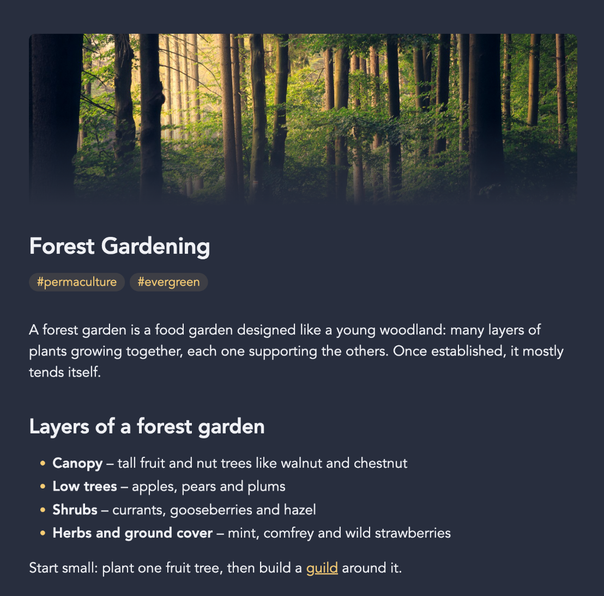

# Banners

A [Digital Garden](https://github.com/oleeskild/digitalgarden) plugin that
shows a banner image at the top of a note, above the title. It reads the
same frontmatter property your Obsidian banner plugin uses, so a note
looks the same in your vault and on your site.



## Usage

Set a banner image in the note's frontmatter, the way your Obsidian banner
plugin does:

```yaml
---
banner: "[[Banners/sunrise.png]]"
---
```

Works out of the box with:

| Obsidian plugin | Image property | Position property |
| --- | --- | --- |
| [Note Banners](https://github.com/bagoftips/Note-Banners) | `art` | `banner-pos` (-100 bottom … 0 center … 100 top) |
| [Banners](https://github.com/noatpad/obsidian-banners) | `banner` | `banner_y` (0 top … 1 bottom) |
| [Banners Reloaded](https://github.com/dgcreations00/obsidian-banners-reloaded) | `banner` | `banner_y` (0% top … 100% bottom) |
| [Pixel Banner](https://github.com/jparkerweb/pixel-banner) | `banner` | `banner-y` (0 top … 100 bottom) |
| [Pretty Properties](https://github.com/anareaty/pretty-properties) | `banner` | `banner_position` (0 top … 100 bottom) |
| [Banner Images](https://github.com/saltyfireball/obsidian-banner-images) | `banner_image`, `backdrop` | `banner_offset` (`top`, `center`, `bottom` or 0% … 100%) |

The image can be a wikilink (`[[image.png]]`, `![[image.png]]`), a
markdown link (``), a vault path, or an external `https://`
URL. Images from your vault are published along with the note.
`banner: false` or `banner: none` turns the banner off for a note.

Pixel Banner keyword banners (like `banner: mountains`) pick a random
photo from Pexels or Unsplash each time Obsidian loads the note, so there
is no image to publish and the note gets no banner. Run Pixel Banner's
**Pin** command on the note to save the photo to your vault; it then
shows up on your site too.

## Settings

| Setting | Default | Description |
| --- | --- | --- |
| Banner properties | `banner, banner_image, backdrop, art` | Frontmatter properties to read the image from, comma-separated. The first one a note has is used. Change it if you've renamed the property in your Obsidian banner plugin. |
| Height | `220` | Banner height in pixels. Narrow screens get a shorter banner. |
| Fade into page | `true` | Fade the bottom of the banner into the page background. |
| Show on home page | `true` | Also show a banner on the home page when it has one. |

Can also be set via `BANNERS_PROPERTIES`, `BANNERS_HEIGHT`, `BANNERS_FADE`
and `BANNERS_APPLY_TO_HOME` in the garden's `.env`.

Banners are left out of link previews and search previews.

## Install

Paste this repo's URL into the plugin installer of your garden, or copy
the plugin directory into `src/plugins/banners/` manually.

Screenshot photo from [Unsplash](https://unsplash.com).
