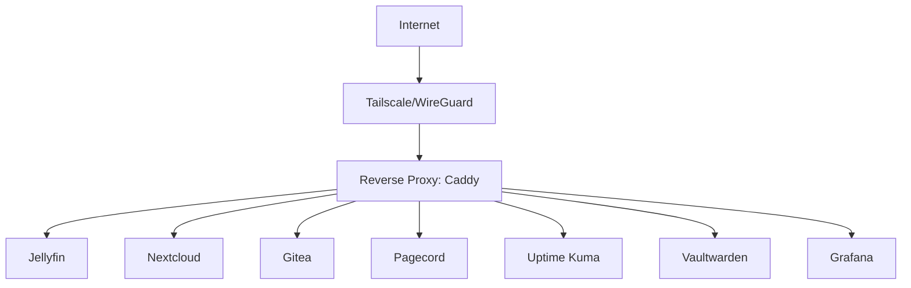

---
{"dg-publish":true,"permalink":"/50-projects/51-homelab/homelab-readme/","noteIcon":"","created":"2026-10-31T01:56:07.281-07:00","updated":"2026-11-01T18:44:22.220-08:00","ctime":"2026-10-31T01:56:07.281-07:00","mtime":"2026-11-01T18:44:22.220-08:00","dg-note-properties":{"growth":"budding"}}
---

Date created: [[20 - Logs/25 - Days/2026-10-31\|2026-10-31]] 
Type: #type/original 
Area: #area/personal-development 
Keywords: #keyword/technology #keyword/cybersecurity 
Last updated: 

---

# Homelab Runbook
## Purpose
Documentation for my [[50 - Projects/Homelab to self-hosting project\|self-hosted homelab]]. Everything here is reproducible from scratch.
# Documentation Structure
```text
50 - Projects/51 - Homelab/
├── README.md # High-level overview, diagram, tech stack
├── docker-compose/ # One folder per service
│ ├── jellyfin/
│ │ └── docker-compose.yml
│ ├── gitea/
│ │ └── docker-compose.yml
│ └── ...
├── scripts/ # Backup scripts, cron jobs, etc.
├── docs/
│ ├── architecture.md # Network diagram, data flow
│ ├── security.md # Firewall rules, hardening steps, Fail2ban config
│ ├── backup.md # What's backed up, how, restore test procedure
│ └── runbooks/ # "How to restart Plex", "How to update Nextcloud"
└── configs/ # Custom nginx/caddy configs, systemd units
```
**Key documentation habits:**
- Write the README first (your vision), then update it as you go. Don't wait until the end.
- For each service, note: what it does, what port it uses, what volumes it needs, and how to back it up.
- Commit early, commit often. Use clear commit messages like "add gitea container" or "harden ssh: disable password auth."
- In `security.md`, document exactly what you hardened and why. "Disabled password auth, enabled key-only, set up CrowdSec with the ssh-bruteforce scenario" is a great line.
# Architecture
## Current arch setup
- Single Ubuntu Server VM on VirtualBox
## Future arch

- Docker for all services
- Caddy reverse proxy
- Prometheus + Grafana for monitoring
- UFW firewall, fail2ban, `auditd`, AIDE for security

## Quick Links
- Gitea: http://[vm-ip]:3000 
- Grafana: http://[vm-ip]:3001
## Security Status
## Current security measures
- On an air-gapped VM
- Not accessible via the Internet
## Future lockdown steps
- SSH: key-only, root disabled
- Firewall: UFW default deny
- Intrusion detection: fail2ban active
- File integrity: AIDE baseline taken
- Audit: `auditd` watching /etc/passwd
## Recovery
See `06-troubleshooting/recovery.md` ([[50 - Projects/51 - Homelab/Homelab Recovery\|Homelab Recovery]])
## Changelog
- 2026-10-20: VM setup and snapshots lab (03:18pm)
